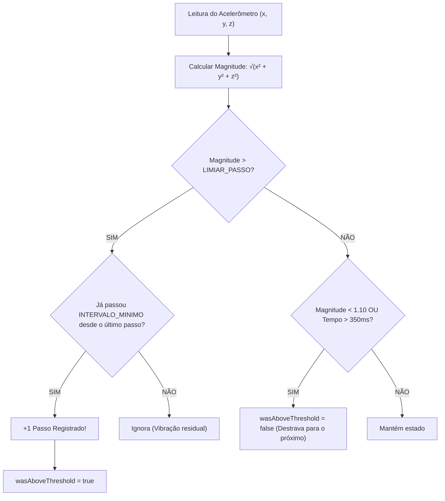

# 🎯 Guia Definitivo de Calibração do Contador de Passos (Acelerômetro)

Este tutorial ensina em detalhes **como funciona**, **como ajustar** e **como calibrar** o algoritmo de contagem de passos baseado no sensor de acelerômetro do **GeoPassos / Sensor Tracker**.

---

## 📋 Índice

1. [Como o Acelerômetro Enxerga o Passo Humano](#1-como-o-acelerômetro-enxerga-o-passo-humano)
2. [A Fórmula da Magnitude Vetorial](#2-a-fórmula-da-magnitude-vetorial)
3. [Os 4 Parâmetros Fundamentais de Calibração](#3-os-4-parâmetros-fundamentais-de-calibração)
4. [O Ciclo do Algoritmo (Gráfico e Lógica)](#4-o-ciclo-do-algoritmo-gráfico-e-lógica)
5. [Protocolo Prático de Calibração (Teste dos 20 Passos)](#5-protocolo-prático-de-calibração-teste-dos-20-passos)
6. [Tabela de Ajustes por Cenário de Uso](#6-tabela-de-ajustes-por-cenário-de-uso)
7. [Como Alterar os Valores no Código (`CardPassos.js`)](#7-como-alterar-os-valores-no-código-cardpassosjs)

---

## 1. Como o Acelerômetro Enxerga o Passo Humano

O acelerômetro mede forças de aceleração nos três eixos espaciais:
- **Eixo X**: Movimento lateral (esquerda ↔ direita).
- **Eixo Y**: Movimento vertical (cima ↕ baixo).
- **Eixo Z**: Movimento de profundidade (frente ↔ trás).

### As duas fases da marcha humana:

```text
       Impacto no Chão (Pico de Aceleração)
                ▲
               / \           LIMIAR_PASSO (ex: 1.18g)
--------------/---\---------------------------------
             /     \
            /       \
-----------/---------\------------------------------ Gravidade Normal (1.0g)
                      \     /
                       \---/
             Fase de Balanço (Vale de Aceleração)
```

1. **Repouso**: Com o celular imóvel sobre a mesa, a aceleração total é exatamente **$1.0g$** (força da gravidade terrestre, onde $1g \approx 9.81 \, m/s^2$).
2. **Impacto do Pé (*Heel Strike*)**: Quando o calcanhar toca o chão, a onda de choque sobe pelo corpo e atinge o celular, gerando um **pico brusco** de aceleração ($1.15g \sim 1.50g$).
3. **Fase de Balanço (*Swing Phase*)**: Enquanto a perna está no ar avançando, a aceleração momentaneamente cai abaixo de $1.0g$ ($0.8g \sim 0.95g$).

---

## 2. A Fórmula da Magnitude Vetorial

O usuário pode segurar o celular de pé, deitado, no bolso ou de cabeça para baixo. Para que a contagem funcione **em qualquer posição**, calculamos a **Magnitude Vetorial Tridimensional**:

$$\text{Magnitude} = \sqrt{x^2 + y^2 + z^2}$$

No código JavaScript:
```javascript
const magnitude = Math.sqrt(x * x + y * y + z * z);
```

> **Por que isso é importante?**
> A magnitude combina os 3 eixos em um único valor absoluto. Se você virar o celular de lado ou colocá-lo no bolso na diagonal, a força do passo continua sendo detectada perfeitamente.

---

## 3. Os 4 Parâmetros Fundamentais de Calibração

No arquivo `src/components/CardPassos.js`, você encontra quatro constantes que controlam o comportamento do sensor:

| Parâmetro | Linha no Código | Valor Atual | O que controla |
| :--- | :--- | :--- | :--- |
| **`Update Interval`** | `Accelerometer.setUpdateInterval(50)` | `50 ms` (20 Hz) | Frequência de leitura do sensor |
| **`LIMIAR_PASSO`** | `const LIMIAR_PASSO = 1.18;` | `1.18 g` | Força mínima do impacto para contar |
| **`INTERVALO_MINIMO`**| `const INTERVALO_MINIMO = 260;` | `260 ms` | Tempo mínimo entre dois passos |
| **`TIMEOUT_RESET`** | `now - lastStepTime.current > 350` | `350 ms` | Tempo para destravar o próximo passo |

---

### Detalhamento de cada parâmetro:

### 1️⃣ Taxa de Amostragem (`setUpdateInterval`)
- **Valor recomendado:** `40ms` a `50ms` (20 a 25 leituras por segundo).
- **Se colocar muito alto (ex: 100ms):** O pico do passo dura apenas ~60ms. Uma taxa lenta "passa batido" e o contador parece lento ou perde passos.
- **Se colocar muito baixo (ex: 10ms):** Consome bateria desnecessariamente sem ganho perceptível.

### 2️⃣ Limiar de Impacto (`LIMIAR_PASSO`)
- **Valor padrão calibrado:** `1.18`
- **Se você diminuir (ex: 1.12):** Fica mais sensível. Ideal para pessoas que caminham muito suavemente, idosos ou pessoas segurando o celular na mão com o braço relaxado.
- **Se você aumentar (ex: 1.25):** Fica mais rígido. Evita que gestos de braço ou digitação no celular sejam contados como passos por engano.

### 3️⃣ Filtro de Cooldown (`INTERVALO_MINIMO`)
- **Valor padrão calibrado:** `260 ms`
- O ser humano mais rápido do mundo correndo atinge cerca de 4 a 4.5 passos por segundo ($1000ms / 4.5 \approx 222ms$).
- Na caminhada rápida, raramente se passa de 3.5 passos por segundo ($1000ms / 3.5 \approx 285ms$).
- **Para que serve:** Cada passo gera uma vibração residual de rebote. O `INTERVALO_MINIMO` impede que um único passo seja contado 2 ou 3 vezes.

### 4️⃣ Histerese e Destravamento
- Quando o passo é detectado, a variável `wasAboveThreshold` vira `true` (trava).
- Ela só volta a `false` (pronta para o próximo) quando:
  - A magnitude cai abaixo de `1.10g`; **OU**
  - Já se passaram mais de `350ms` desde o último passo (evitando travamentos em ritmos constantes).

---

## 4. O Ciclo do Algoritmo (Gráfico e Lógica)



---

## 5. Protocolo Prático de Calibração (Teste dos 20 Passos)

Para calibrar o app sob medida para o seu corpo ou aparelho:

1. Abra o app e toque em **"🔄 Zerar contador"**.
2. Toque em **"▶ Iniciar contador"**.
3. Caminhe contando mentalmente **exatamente 20 passos** em ritmo natural.
4. Pare e olhe o número na tela:

| Resultado na Tela | Diagnóstico | O que ajustar |
| :---: | :---: | :--- |
| **19 a 21 passos** | **Perfeito!** | Calibração ideal. |
| **Menos de 18 passos** | **Sub-contagem** (Perdendo passos) | **Reduza** o `LIMIAR_PASSO` (de `1.18` para `1.14` ou `1.12`). |
| **Mais de 22 passos** | **Sobre-contagem** (Contando passos fantasmas) | **Aumente** o `LIMIAR_PASSO` (de `1.18` para `1.22`) ou aumente o `INTERVALO_MINIMO` para `290`. |

---

## 6. Tabela de Ajustes por Cenário de Uso

Dependendo de onde o usuário carrega o celular, a intensidade do sinal muda drasticamente:

| Posição do Celular | Amortecimento | Limiar Recomendado | Intervalo Mínimo |
| :--- | :--- | :---: | :---: |
| **Na mão olhando para a tela** | Alto (o braço amortece) | `1.15` a `1.18` | `260 ms` |
| **No bolso da calça (jeans)** | Baixo (transmissão direta da perna) | `1.22` a `1.26` | `280 ms` |
| **Na mão balançando ao lado** | Médio | `1.18` a `1.22` | `260 ms` |
| **Na mochila / bolsa** | Muito alto | `1.12` a `1.15` | `300 ms` |
| **Corrida / Cooper** | Muito baixo (impacto forte) | `1.30` a `1.40` | `220 ms` |

---

## 7. Como Alterar os Valores no Código (`CardPassos.js`)

Abra o arquivo [src/components/CardPassos.js](file:///c:/Users/sn1090634/Desktop/contador-passos/geo-passos/src/components/CardPassos.js) e localize a função `iniciarComAcelerometro`:

```javascript
function iniciarComAcelerometro() {
  try {
    setTipoSensor('accelerometer');
    setMensagem('');
    
    // 1. Taxa de amostragem (em ms)
    Accelerometer.setUpdateInterval(50);

    const novaSubscricao = Accelerometer.addListener((data) => {
      const { x, y, z } = data;
      const magnitude = Math.sqrt(x * x + y * y + z * z);
      const now = Date.now();

      // ==========================================
      // AJUSTES DE CALIBRAÇÃO AQUI:
      // ==========================================
      const LIMIAR_PASSO = 1.18;    // Diminua para +sensível, aumente para -sensível
      const INTERVALO_MINIMO = 260; // Tempo mínimo entre passos em ms

      if (magnitude > LIMIAR_PASSO && !wasAboveThreshold.current) {
        if (now - lastStepTime.current > INTERVALO_MINIMO) {
          wasAboveThreshold.current = true;
          lastStepTime.current = now;
          setPassos((prev) => prev + 1);
        }
      } else if (magnitude < 1.10 || now - lastStepTime.current > 350) {
        wasAboveThreshold.current = false;
      }
    });

    setSubscription(novaSubscricao);
    setAtivo(true);
  } catch (error) {
    console.log(error);
    setMensagem('Não foi possível iniciar o acelerômetro.');
  }
}
```

---

Desenvolvido para o projeto **GeoPassos / Sensor Tracker**. Use este guia como referência para aulas, testes práticos e calibragem de sensores nativos no Expo.
